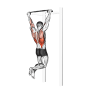
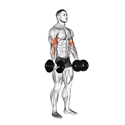
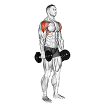

# 💪 Exercises Dataset — 中文增强版

<div align="center">

<p>
  
  
  
  
  
  
</p>

**包含 1,324 个健身动作的综合数据集 — 每个动作配有动画 GIF、180×180 缩略图、肌肉群与器械分类、以及 10 种语言的步骤说明（英文、西班牙文、意大利文、土耳其文、俄文、中文、印地文、波兰文、韩文、法文）。**

[](data/exercises.json)
[](videos/)
[](images/)
[](#-overview)
[](data/name_zh.json)
[](LICENSE)

</div>

> **⚠️ 这是 [hasaneyldrm/exercises-dataset](https://github.com/hasaneyldrm/exercises-dataset) 的 Fork 增强版本。** 原版项目**最初包含** `images/` 和 `videos/` 目录，后因多方版权争议主动移除，并将 `exercises.json` 中的 `image`/`gif_url` 字段置为 `null`。本版本保留了原始仓库移除前的完整媒体文件，并新增了中文化界面、动作名中文翻译等功能。详见 [与原始项目的区别](#-与原始项目的区别)。

---

## 📋 目录

- [与原始项目的区别](#-与原始项目的区别)
- [数据来源](#-数据来源)
- [概览](#-概览)
- [交互式浏览器 & 开发者工具](#️-交互式浏览器--开发者工具)
- [文件结构](#-文件结构)
- [统计数据](#-统计数据)
- [数据 Schema](#-数据-schema)
- [使用示例](#-使用示例)
- [中文动作名使用](#-中文动作名使用)
- [License & 许可](#-license--许可)

---

## 🆚 与原始项目的区别

本项目基于 [hasaneyldrm/exercises-dataset](https://github.com/hasaneyldrm/exercises-dataset)，做了以下增强和修改：

| 项目 | 原始仓库 | 本仓库 |
|---|---|---|
| `images/` 目录 | ⚠️ **曾包含，后因版权争议移除** | ✅ **保留** (1,324 张 180×180 缩略图) |
| `videos/` 目录 | ⚠️ **曾包含，后因版权争议移除** | ✅ **保留** (1,324 个 180×180 动画 GIF) |
| `exercises.json` 中 `image`/`gif_url` | ⚠️ 已置为 `null`，仅保留 `media_id` | ✅ **保留原始路径** (如 `images/0001-xxx.jpg`) |
| `index.html` | 英文界面 | ✅ **重构为中文界面** (动作库浏览器) |
| `setup.html` | 英文开发者工具 | ✅ **重构为中文界面** (开发者设置向导) |
| 中文动作名 | ❌ 无 | ✅ **1,319 个动作名中文翻译** |
| `data/name_zh.json` | ❌ 无 | ✅ 中文动作名映射 (JSON) |
| `data/name_zh.js` | ❌ 无 | ✅ 中文动作名映射 (浏览器可直接引用) |
| `all_names.txt` | ❌ 无 | ✅ 全部 1,324 个动作英文名列表 |
| `build_zh.js` | ❌ 无 | ✅ 中文翻译生成脚本 (Node.js) |
| 动作指令中文 | ✅ 有 (`instructions.zh`) | ✅ 保留不变 |
| 原始 `exercises.json` 数据 | ✅ 1,324 条 | ✅ 保留不变 |

> 详细差异说明请参见 [DIFFERENCES.md](DIFFERENCES.md)。

---

## 📦 数据来源

本项目数据源自 **ExerciseDB v1 by AscendAPI**，通过 Kaggle 重新分发。

**本仓库提供：**

- 1,324 个健身动作，含分类、身体部位、器械、目标和肌肉群数据
- 每个动作配 1 个动画 GIF + 1 张 180×180 缩略图（媒体 © [Gym visual](https://gymvisual.com/) — 见 [License](#-license--许可)）
- 10 种语言的逐步说明（🇬🇧 英文 · 🇪🇸 西班牙文 · 🇮🇹 意大利文 · 🇹🇷 土耳其文 · 🇷🇺 俄文 · 🇨🇳 中文 · 🇮🇳 印地文 · 🇵🇱 波兰文 · 🇰🇷 韩文 · 🇫🇷 法文）
- **🆕 1,319 个动作名的中文翻译**
- **🆕 全中文化的交互式浏览器 (`index.html`) 和开发者设置向导 (`setup.html`)**

---

## 🔍 概览

该数据集精选了 **1,324 个健身动作**，适用于教育和研究目的。覆盖了广泛的肌肉群、器械类型和动作类别，非常适合：

- 构建健身或训练计划应用
- 涉及动作识别或推荐的机器学习项目
- 健康与健身研究
- 教育演示和原型开发

每个动作条目包含：

| 字段 | 说明 |
|---|---|
| 唯一 ID | 数字标识符 (如 `"0001"`) |
| 名称 | 完整动作名称 |
| 分类 | 主要目标肌肉群 |
| 目标 | 具体目标肌肉 |
| 肌肉群 | 协同/辅助肌肉 |
| 器械 | 所需器械 (或 `body weight` 表示自重) |
| 说明 | 每个动作的逐步说明 |
| 可用语言 | 🇬🇧 英文 · 🇪🇸 西班牙文 · 🇮🇹 意大利文 · 🇹🇷 土耳其文 · 🇷🇺 俄文 · 🇨🇳 中文 · 🇮🇳 印地文 · 🇵🇱 波兰文 · 🇰🇷 韩文 · 🇫🇷 法文 |
| 媒体 | 每动作 1 张 180×180 缩略图 + 1 个动画 GIF — 媒体 © Gym visual，见 [License](#-license--许可) |

---

## 🖥️ 交互式浏览器 & 开发者工具

本仓库包含两个可直接使用的 HTML 工具 — 无需服务器，浏览器直接打开即可。

### `index.html` — 动作库浏览器

一个全客户端动作浏览器，功能包括：
- 🔍 搜索全部 1,324 个动作
- 📂 按分类、器械和目标肌肉筛选
- 📜 无限滚动网格布局
- 🀄 **全中文界面**，支持 10 种语言说明切换
- 🎬 每个动作显示动画 GIF 和缩略图
- 🏷️ **显示中文动作名**（基于 `name_zh.js`）

### `setup.html` — 开发者设置向导

帮助开发者将数据集集成到自己的应用中：

1. **数据库设置** — 一键生成 SQL Server、PostgreSQL、MySQL 和 SQLite 的 `CREATE TABLE` 语句和全部 1,324 条 INSERT 语句
2. **API 集成** — 提供 **JavaScript、Python、C#、Java、PHP、Go 和 cURL** 的复制粘贴代码示例
3. **LLM 提示词** — 结构化提示词，可粘贴到 ChatGPT、Claude 或 Gemini 中一键生成完整的 REST API（支持 Express.js、FastAPI、ASP.NET Core、Spring Boot、Laravel 和 Gin）

---

## 📂 文件结构

```
exercises-dataset/
├── data/
│   ├── exercises.json         # 完整数据集 — 1,324 条动作记录
│   ├── exercises.schema.json  # JSON Schema (2020-12) 用于验证
│   ├── name_zh.json           # 🆕 中文动作名映射 (JSON 格式)
│   └── name_zh.js             # 🆕 中文动作名映射 (JS 全局变量)
├── images/                    # 1,324 × 180×180 缩略图 (© Gym visual)
├── videos/                    # 1,324 × 180×180 动画 GIF (© Gym visual)
├── index.html                 # 🆕 中文动作库浏览器
├── setup.html                 # 🆕 中文开发者设置向导
├── all_names.txt              # 🆕 全部动作英文名列表
├── build_zh.js                # 🆕 中文翻译生成脚本
├── NOTICE.md                  # 媒体版权归属说明
├── DIFFERENCES.md             # 🆕 与原始项目的详细差异
├── LICENSE
└── README.md
```

---

## 📊 统计数据

| 指标 | 数量 |
|---|---|
| 总动作数 | **1,324** |
| 说明语言数 | **10** |
| 中文动作名翻译 | **1,319** |
| 动画 GIF | **1,324** |
| 缩略图 | **1,324** |

### 按身体部位分类

| 身体部位 | 动作数量 |
|---|---|
| 上臂 (Upper Arms) | 292 |
| 大腿 (Upper Legs) | 227 |
| 背部 (Back) | 203 |
| 腰部 (Waist) | 169 |
| 胸部 (Chest) | 163 |
| 肩部 (Shoulders) | 143 |
| 小腿 (Lower Legs) | 59 |
| 前臂 (Lower Arms) | 37 |
| 有氧 (Cardio) | 29 |
| 颈部 (Neck) | 2 |

### 按器械分类

| 器械 | 动作数量 |
|---|---|
| 自重 (Body Weight) | 325 |
| 哑铃 (Dumbbell) | 294 |
| 绳索 (Cable) | 157 |
| 杠铃 (Barbell) | 154 |
| 杠杆机 (Leverage Machine) | 81 |
| 弹力带 (Band) | 54 |
| 史密斯机 (Smith Machine) | 48 |
| 壶铃 (Kettlebell) | 41 |
| 负重 (Weighted) | 36 |
| 稳定球 (Stability Ball) | 28 |
| 曲杠 (EZ Barbell) | 23 |
| 其他 | 83 |

---

## 🗂️ 数据 Schema

`data/exercises.json` 中每条记录的结构如下。同时提供 [JSON Schema](data/exercises.schema.json) 用于验证。

| 字段 | 类型 | 说明 |
|---|---|---|
| `id` | `string` | 唯一数字 ID（如 `"0001"`） |
| `name` | `string` | 完整动作名称（如 `"3/4 Sit-up"`） |
| `category` | `string` | 身体部位分类 |
| `body_part` | `string` | 目标身体部位 |
| `equipment` | `string` | 所需器械 |
| `instructions.en` ~ `instructions.fr` | `string` | 10 种语言的完整步骤说明 |
| `instruction_steps.<lang>` | `array[string]` | 分步说明数组，每种语言 |
| `muscle_group` | `string` | 主要协同肌肉群 |
| `secondary_muscles` | `array[string]` | 其他参与的肌肉 |
| `target` | `string` | 主要目标肌肉 |
| `media_id` | `string` | 原始媒体引用 ID |
| `image` | `string` | 180×180 缩略图路径 |
| `gif_url` | `string` | 180×180 动画 GIF 路径 |
| `attribution` | `string` | 媒体版权声明 |
| `created_at` | `string` | ISO 8601 时间戳 |

---

## 🚀 使用示例

### Python — 加载与筛选

```python
import json

with open("data/exercises.json", "r", encoding="utf-8") as f:
    exercises = json.load(f)

print(f"总动作数: {len(exercises)}")

# 按分类筛选
chest_exercises = [ex for ex in exercises if ex["category"] == "chest"]
print(f"胸部动作: {len(chest_exercises)}")  # -> 163

# 按器械筛选
bodyweight = [ex for ex in exercises if ex["equipment"] == "body weight"]
print(f"自重动作: {len(bodyweight)}")  # -> 325

# 获取所有分类
categories = sorted({ex["category"] for ex in exercises})
print("分类:", categories)

# 访问多语言说明
ex = exercises[0]
print(ex["instructions"]["en"])  # 英文
print(ex["instructions"]["zh"])  # 中文
```

### Python — 加载中文动作名

```python
import json

with open("data/name_zh.json", "r", encoding="utf-8") as f:
    name_zh = json.load(f)

# 根据英文名获取中文名
english_name = "barbell bench press"
chinese_name = name_zh.get(english_name, english_name)
print(f"{english_name} → {chinese_name}")
# -> barbell bench press → 杠铃 卧推
```

### JavaScript / Node.js

```js
const exercises = require("./data/exercises.json");

console.log(`总动作数: ${exercises.length}`);

// 自重动作
const bodyweight = exercises.filter(ex => ex.equipment === "body weight");
console.log(`自重动作: ${bodyweight.length}`); // -> 325

// 按分类分组
const byCategory = exercises.reduce((acc, ex) => {
  acc[ex.category] = (acc[ex.category] || []);
  acc[ex.category].push(ex);
  return acc;
}, {});

// 访问中文说明
const ex = exercises[0];
console.log(ex.instructions.zh); // 中文
console.log(ex.instructions.en); // 英文
```

### 浏览器中使用中文动作名

```html
<!-- 在 HTML 中引入中文动作名 -->
<script src="data/name_zh.js"></script>
<script>
  // window.NAME_ZH 全局变量已可用
  const zhName = window.NAME_ZH["barbell bench press"];
  console.log(zhName); // -> "杠铃 卧推"

  // 获取某个动作的中文名
  function getChineseName(englishName) {
    return window.NAME_ZH[englishName] || englishName;
  }
</script>
```

### TypeScript

```typescript
// 导入中文动作名映射
import nameZhData from "./data/name_zh.json";

// 类型安全的访问
const nameZh: Record<string, string> = nameZhData;
const zhName = nameZh["barbell bench press"]; // "杠铃 卧推"
```

---

## 🀄 中文动作名使用

### name_zh.json

JSON 格式，键为英文动作名，值为中文翻译：

```json
{
  "barbell bench press": "杠铃 卧推",
  "barbell deadlift": "杠铃 硬拉",
  "pull-up": "引体向上",
  "dumbbell biceps curl": "哑铃 肱二头肌弯举"
}
```

### name_zh.js

与 `name_zh.json` 内容相同，但以 JavaScript 全局变量的形式提供：

```javascript
window.NAME_ZH = {
  "barbell bench press": "杠铃 卧推",
  // ... 共 1,319 条
};
```

直接在 HTML 中通过 `<script src="data/name_zh.js"></script>` 引入即可使用。

### build_zh.js

用于从英文动作名列表生成中文翻译的 Node.js 脚本。工作流程：

1. 读取 `all_names.txt`（全部 1,324 个英文动作名）
2. 使用内置的术语表和组合逻辑进行翻译
3. 生成 `data/name_zh.json` 和 `data/name_zh.js`

```bash
# 运行翻译生成
node build_zh.js
```

### 翻译策略

翻译采用**术语组合**方式，主要策略包括：

- **固定词组直译**：如 "barbell" → "杠铃"，"dumbbell" → "哑铃"，"bench press" → "卧推"
- **身体部位翻译**：如 "biceps" → "肱二头肌"，"triceps" → "肱三头肌"，"pectoralis" → "胸肌"
- **动作类型翻译**：如 "curl" → "弯举"，"raise" → "抬举/平举"，"fly" → "飞鸟"，"squat" → "深蹲"
- **方向/姿态翻译**：如 "incline" → "上斜"，"decline" → "下斜"，"seated" → "坐姿"，"lying" → "仰卧"
- **复合名称组合**：按照中文语序重新组合各术语

> ⚠️ 当前翻译覆盖率为 99.6%（1,319/1,324），部分非常用动作名可能尚未翻译，欢迎贡献改进。

---

## 📄 License & 许可

本仓库是 **开发者工具与结构化健身数据集** — 包含动作元数据、多语言说明翻译和 180×180 动作演示媒体。

- **代码、工具、数据集结构、说明文字** 采用 [MIT License](LICENSE)。
- **动作演示媒体（图片 & GIF）© [Gym visual](https://gymvisual.com/)**，经授权以 180×180 分辨率在此分发 — 详见 [`NOTICE.md`](NOTICE.md) 和 [`LICENSE`](LICENSE)。请保留 `© Gym visual — https://gymvisual.com/` 的版权声明。二次使用受 [Gym visual 条款与条件](https://gymvisual.com/content/3-terms-and-conditions-of-use) 约束，在复用媒体内容前请自行获取授权。
- **中文动作名翻译 (`name_zh.json`, `name_zh.js`)** 为新增内容，同样采用 MIT License。
- 本仓库**不主张**对底层动作内容或媒体的所有权。

---

## 🙏 致谢

- **原始数据集**: [hasaneyldrm/exercises-dataset](https://github.com/hasaneyldrm/exercises-dataset) — 健身动作数据集的基础工作
- **数据来源**: ExerciseDB v1 by AscendAPI
- **动作媒体**: © [Gym visual](https://gymvisual.com/)
